# Uncertainty quantification report

Generated by the UQ pipeline. Do not edit numbers by hand.

## Setup

- Split type: run-level (grouped by scan family, stratified by material), manifest hash `379bff64a42d7eb41d1dd7d424656c6cd89ea4fcc0b5351ebc2af80f4f42f3de`.
- Runs per set: {'cal': 12, 'test': 9, 'train': 21, 'val': 3}.
- Pre-registered config hash `955fabfd365fb9b05d71dd53a701b30445eb218c0ead471a0da523f58e2301d4`: K = 16, alphas = [0.2, 0.1, 0.05], primary method = absolute, primary alpha = 0.1, seeds = 7001, 7002, 7003.
- Seed derivation: `SeedSequence([base seed, crc32(set name)])` per set, then `SeedSequence([set seed, input index])` per input.
- Training: {'best_epoch': 17, 'epochs_run': 33, 'stopped_early': True}.
- Confidence intervals: Wilson 95% (assumes independent samples, too narrow for within-run data) and run-level percentile bootstrap 95% (2000 resamples, seed 7003). Prefer the bootstrap.
- Methods: `absolute` (conformal on residuals of the ensemble mean), `normalized` (residual / (spread + eps)), `constant_single_draw` (constant-width baseline: conformal on one draw, no ensemble), and `raw_ensemble` (uncalibrated mean +- z sigma, reference only).
- Test-set access: evaluated 1 time.

Conformal coverage assumes exchangeable samples. Samples within a run are correlated, so the guarantee holds only loosely here. An alpha marked `not supported at run level` lacks enough calibration runs for a finite quantile when each run counts once. Its sample-level number is shown but carries no run-level guarantee.

Models are never ranked across different run-disjoint labels.

## Results

### Baseline (pre-step mask)

**run-disjoint: yes (checkpoint manifest matches)**

n_cal = 590 (12 runs), n_test = 450 (9 runs), K = 16, base sampling seed = 7001.

Point error of the ensemble mean on the test runs:

| quantity | n | mae | rmse | bias | mean_spread |
| --- | --- | --- | --- | --- | --- |
| depth_vox | 450 | 9.372 | 14.414 | 9.349 | 1.011 |
| T_max_K | 450 | 1103 | 1582 | 229 | 184 |
| volume_vox | 450 | 9581 | 14202 | 8916 | 1112 |

Coverage over all test samples:

| quantity | alpha | method | n | coverage | Wilson_95 | run_bootstrap_95 | mean_width | median_width | interval_score | support |
| --- | --- | --- | --- | --- | --- | --- | --- | --- | --- | --- |
| depth_vox | 0.200 | absolute | 450 | 0.684 | 0.640 to 0.726 | 0.411 to 0.922 | 30.000 | 30.000 | 57.193 | supported |
| depth_vox | 0.200 | normalized | 450 | 0.856 | 0.820 to 0.885 | 0.633 to 0.991 | 32.839 | 0.000 | 48.232 | supported |
| depth_vox | 0.200 | constant_single_draw | 450 | 0.689 | 0.645 to 0.730 | 0.424 to 0.918 | 30.000 | 30.000 | 58.311 | supported |
| depth_vox | 0.200 | raw_ensemble | 450 | 0.498 | 0.452 to 0.544 | 0.198 to 0.804 | 2.592 | 0.000 | 83.577 | supported |
| depth_vox | 0.100 | absolute | 450 | 0.847 | 0.810 to 0.877 | 0.622 to 0.980 | 44.375 | 44.375 | 64.917 | supported |
| depth_vox | 0.100 | normalized | 450 | 0.931 | 0.904 to 0.951 | 0.807 to 1.000 | 1820053584 | 18.000 | 1820053591 | supported |
| depth_vox | 0.100 | constant_single_draw | 450 | 0.842 | 0.806 to 0.873 | 0.624 to 0.978 | 44.000 | 44.000 | 67.022 | supported |
| depth_vox | 0.100 | raw_ensemble | 450 | 0.502 | 0.456 to 0.548 | 0.198 to 0.811 | 3.326 | 0.000 | 158 | supported |
| depth_vox | 0.050 | absolute | 450 | 0.891 | 0.859 to 0.917 | 0.700 to 0.993 | 55.500 | 55.500 | 65.911 | not supported at run level |
| depth_vox | 0.050 | normalized | 450 | 0.967 | 0.946 to 0.980 | 0.904 to 1.000 | 2831194464 | 28.000 | 2831194469 | not supported at run level |
| depth_vox | 0.050 | constant_single_draw | 450 | 0.949 | 0.924 to 0.966 | 0.860 to 0.998 | 58.000 | 58.000 | 68.667 | not supported at run level |
| depth_vox | 0.050 | raw_ensemble | 450 | 0.507 | 0.461 to 0.553 | 0.200 to 0.818 | 3.964 | 0.000 | 301 | not supported at run level |
| T_max_K | 0.200 | absolute | 450 | 0.751 | 0.709 to 0.789 | 0.511 to 0.956 | 2417 | 2417 | 5557 | supported |
| T_max_K | 0.200 | normalized | 450 | 0.729 | 0.686 to 0.768 | 0.473 to 0.938 | 2660 | 2465 | 6170 | supported |
| T_max_K | 0.200 | constant_single_draw | 450 | 0.767 | 0.725 to 0.803 | 0.547 to 0.936 | 2550 | 2550 | 5643 | supported |
| T_max_K | 0.200 | raw_ensemble | 450 | 0.133 | 0.105 to 0.168 | 0.000 to 0.331 | 472 | 437 | 9291 | supported |
| T_max_K | 0.100 | absolute | 450 | 0.851 | 0.815 to 0.881 | 0.633 to 1.000 | 2894 | 2894 | 8245 | supported |
| T_max_K | 0.100 | normalized | 450 | 0.816 | 0.777 to 0.849 | 0.589 to 0.982 | 3354 | 3108 | 9238 | supported |
| T_max_K | 0.100 | constant_single_draw | 450 | 0.862 | 0.827 to 0.891 | 0.649 to 0.982 | 3114 | 3114 | 8274 | supported |
| T_max_K | 0.100 | raw_ensemble | 450 | 0.156 | 0.125 to 0.192 | 0.004 to 0.371 | 605 | 560 | 17075 | supported |
| T_max_K | 0.050 | absolute | 450 | 0.887 | 0.854 to 0.913 | 0.671 to 1.000 | 3471 | 3471 | 12750 | not supported at run level |
| T_max_K | 0.050 | normalized | 450 | 0.884 | 0.852 to 0.911 | 0.676 to 1.000 | 4242 | 3931 | 14073 | not supported at run level |
| T_max_K | 0.050 | constant_single_draw | 450 | 0.887 | 0.854 to 0.913 | 0.671 to 1.000 | 3665 | 3665 | 12609 | not supported at run level |
| T_max_K | 0.050 | raw_ensemble | 450 | 0.200 | 0.166 to 0.239 | 0.027 to 0.422 | 721 | 668 | 31724 | not supported at run level |
| volume_vox | 0.200 | absolute | 450 | 0.838 | 0.801 to 0.869 | 0.602 to 0.976 | 33294 | 33294 | 53614 | supported |
| volume_vox | 0.200 | normalized | 450 | 0.829 | 0.791 to 0.861 | 0.599 to 0.989 | 32116 | 31617 | 52920 | supported |
| volume_vox | 0.200 | constant_single_draw | 450 | 0.831 | 0.794 to 0.863 | 0.596 to 0.973 | 33450 | 33450 | 53822 | supported |
| volume_vox | 0.200 | raw_ensemble | 450 | 0.120 | 0.093 to 0.153 | 0.044 to 0.204 | 2851 | 2806 | 84846 | supported |
| volume_vox | 0.100 | absolute | 450 | 0.887 | 0.854 to 0.913 | 0.678 to 0.996 | 44694 | 44694 | 70164 | supported |
| volume_vox | 0.100 | normalized | 450 | 0.893 | 0.861 to 0.919 | 0.687 to 1.000 | 46210 | 45492 | 69727 | supported |
| volume_vox | 0.100 | constant_single_draw | 450 | 0.889 | 0.856 to 0.915 | 0.678 to 0.998 | 44758 | 44758 | 69975 | supported |
| volume_vox | 0.100 | raw_ensemble | 450 | 0.162 | 0.131 to 0.199 | 0.064 to 0.264 | 3659 | 3602 | 160305 | supported |
| volume_vox | 0.050 | absolute | 450 | 0.909 | 0.879 to 0.932 | 0.731 to 1.000 | 54298 | 54298 | 85587 | not supported at run level |
| volume_vox | 0.050 | normalized | 450 | 0.929 | 0.901 to 0.949 | 0.787 to 1.000 | 57133 | 56245 | 84804 | not supported at run level |
| volume_vox | 0.050 | constant_single_draw | 450 | 0.909 | 0.879 to 0.932 | 0.731 to 1.000 | 53548 | 53548 | 85888 | not supported at run level |
| volume_vox | 0.050 | raw_ensemble | 450 | 0.207 | 0.172 to 0.246 | 0.084 to 0.336 | 4360 | 4292 | 305268 | not supported at run level |

Coverage per material (absolute, alpha = 0.1):

| quantity | stratum | n | n_runs | coverage | Wilson_95 | run_bootstrap_95 | mean_width |
| --- | --- | --- | --- | --- | --- | --- | --- |
| depth_vox | IN718 | 150 | 3 | 0.667 | 0.588 to 0.737 | 0.000 to 1.000 | 44.375 |
| depth_vox | SS316L | 150 | 3 | 0.873 | 0.811 to 0.917 | 0.800 to 1.000 | 44.375 |
| depth_vox | Ti64 | 150 | 3 | 1.000 | 0.975 to 1.000 | 1.000 to 1.000 | 44.375 |
| T_max_K | IN718 | 150 | 3 | 1.000 | 0.975 to 1.000 | 1.000 to 1.000 | 2894 |
| T_max_K | SS316L | 150 | 3 | 0.940 | 0.890 to 0.968 | 0.820 to 1.000 | 2894 |
| T_max_K | Ti64 | 150 | 3 | 0.613 | 0.533 to 0.688 | 0.020 to 1.000 | 2894 |
| volume_vox | IN718 | 150 | 3 | 0.987 | 0.953 to 0.996 | 0.980 to 1.000 | 44694 |
| volume_vox | SS316L | 150 | 3 | 0.687 | 0.609 to 0.755 | 0.060 to 1.000 | 44694 |
| volume_vox | Ti64 | 150 | 3 | 0.987 | 0.953 to 0.996 | 0.960 to 1.000 | 44694 |

Coverage per pattern (absolute, alpha = 0.1):

| quantity | stratum | n | n_runs | coverage | Wilson_95 | run_bootstrap_95 | mean_width |
| --- | --- | --- | --- | --- | --- | --- | --- |
| depth_vox | island | 150 | 3 | 1.000 | 0.975 to 1.000 | 1.000 to 1.000 | 44.375 |
| depth_vox | raster | 150 | 3 | 0.607 | 0.527 to 0.681 | 0.000 to 1.000 | 44.375 |
| depth_vox | zigzag | 150 | 3 | 0.933 | 0.882 to 0.963 | 0.800 to 1.000 | 44.375 |
| T_max_K | island | 150 | 3 | 0.940 | 0.890 to 0.968 | 0.820 to 1.000 | 2894 |
| T_max_K | raster | 150 | 3 | 1.000 | 0.975 to 1.000 | 1.000 to 1.000 | 2894 |
| T_max_K | zigzag | 150 | 3 | 0.613 | 0.533 to 0.688 | 0.020 to 1.000 | 2894 |
| volume_vox | island | 150 | 3 | 0.980 | 0.943 to 0.993 | 0.960 to 1.000 | 44694 |
| volume_vox | raster | 150 | 3 | 0.993 | 0.963 to 0.999 | 0.980 to 1.000 | 44694 |
| volume_vox | zigzag | 150 | 3 | 0.687 | 0.609 to 0.755 | 0.060 to 1.000 | 44694 |

Per-run coverage spread (each test run counted once):

| quantity | min | median | max | count |
| --- | --- | --- | --- | --- |
| T_max_K | 0.020 | 1.000 | 1.000 | 9 |
| depth_vox | 0.000 | 1.000 | 1.000 | 9 |
| volume_vox | 0.060 | 1.000 | 1.000 | 9 |

Depth: zero-depth samples are 0.333 of the test set; domain-limited samples (depth reaches Nz) are 0.493. A zero-depth sample is an easy hit and a domain-limited one is censored, so read these strata separately:

| quantity | stratum | n | n_runs | coverage | Wilson_95 | run_bootstrap_95 | mean_width |
| --- | --- | --- | --- | --- | --- | --- | --- |
| depth_vox | melt_only | 300 | 6 | 0.967 | 0.940 to 0.982 | 0.900 to 1.000 | 44.375 |
| depth_vox | zero_depth | 150 | 3 | 0.607 | 0.527 to 0.681 | 0.000 to 1.000 | 44.375 |
| depth_vox | domain_limited | 222 | 5 | 1.000 | 0.983 to 1.000 | 1.000 to 1.000 | 44.375 |

Volume: zero-volume samples are 0.333 of the test set; patch-limited samples (melt touches a lateral patch face or the bottom) are 0.662. Their true volume is larger than the patch can show, so read these strata separately:

| quantity | stratum | n | n_runs | coverage | Wilson_95 | run_bootstrap_95 | mean_width |
| --- | --- | --- | --- | --- | --- | --- | --- |
| volume_vox | zero_volume | 150 | 3 | 0.993 | 0.963 to 0.999 | 0.980 to 1.000 | 44694 |
| volume_vox | patch_limited | 298 | 6 | 0.832 | 0.786 to 0.870 | 0.520 to 0.997 | 44694 |
| volume_vox | melt_unlimited | 2 | 1 | 1.000 | 0.342 to 1.000 | 1.000 to 1.000 | 44694 |

T_max coverage by true temperature range:

| quantity | stratum | n | n_runs | coverage | Wilson_95 | run_bootstrap_95 | mean_width |
| --- | --- | --- | --- | --- | --- | --- | --- |
| T_max_K | -inf to 2000 K | 150 | 3 | 1.000 | 0.975 to 1.000 | 1.000 to 1.000 | 2894 |
| T_max_K | 2000 to 3000 K | 60 | 3 | 0.867 | 0.758 to 0.931 | 0.758 to 1.000 | 2894 |
| T_max_K | 3000 to 5000 K | 103 | 5 | 0.903 | 0.830 to 0.946 | 0.793 to 1.000 | 2894 |
| T_max_K | 5000 to inf K | 137 | 3 | 0.642 | 0.559 to 0.718 | 0.020 to 1.000 | 2894 |

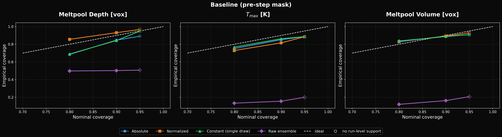

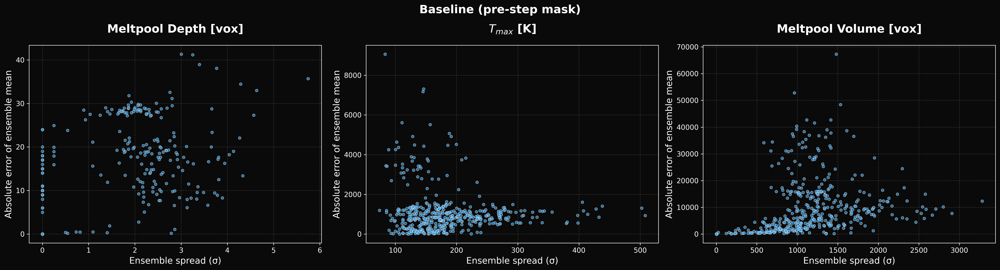

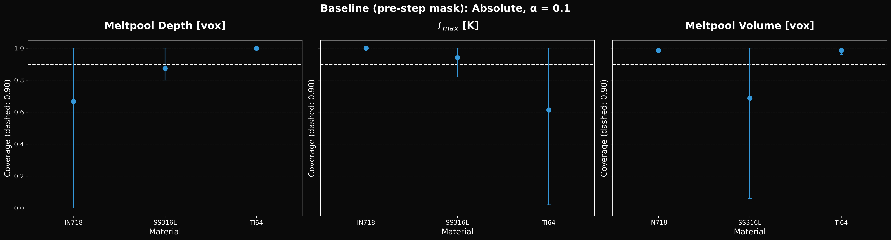

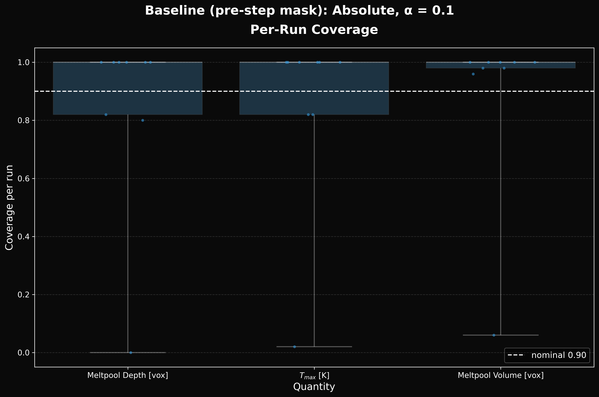

#### Sensitivity (same frozen calibration data, no new sampling)

Coverage and width against K (first K draws):

| K | quantity | alpha | method | coverage | mean_width | n |
| --- | --- | --- | --- | --- | --- | --- |
| 4 | depth_vox | 0.200 | absolute | 0.680 | 30.000 | 450 |
| 4 | depth_vox | 0.200 | normalized | 0.878 | 58.038 | 450 |
| 4 | depth_vox | 0.200 | constant_single_draw | 0.689 | 30.000 | 450 |
| 4 | depth_vox | 0.200 | raw_ensemble | 0.496 | 2.431 | 450 |
| 4 | depth_vox | 0.100 | absolute | 0.844 | 44.500 | 450 |
| 4 | depth_vox | 0.100 | normalized | 0.949 | 2086578482 | 450 |
| 4 | depth_vox | 0.100 | constant_single_draw | 0.842 | 44.000 | 450 |
| 4 | depth_vox | 0.100 | raw_ensemble | 0.502 | 3.120 | 450 |
| 4 | depth_vox | 0.050 | absolute | 0.902 | 55.500 | 450 |
| 4 | depth_vox | 0.050 | normalized | 0.953 | 2655645341 | 450 |
| 4 | depth_vox | 0.050 | constant_single_draw | 0.949 | 58.000 | 450 |
| 4 | depth_vox | 0.050 | raw_ensemble | 0.507 | 3.718 | 450 |
| 4 | T_max_K | 0.200 | absolute | 0.756 | 2470 | 450 |
| 4 | T_max_K | 0.200 | normalized | 0.762 | 3029 | 450 |
| 4 | T_max_K | 0.200 | constant_single_draw | 0.767 | 2550 | 450 |
| 4 | T_max_K | 0.200 | raw_ensemble | 0.113 | 410 | 450 |
| 4 | T_max_K | 0.100 | absolute | 0.849 | 2921 | 450 |
| 4 | T_max_K | 0.100 | normalized | 0.829 | 4149 | 450 |
| 4 | T_max_K | 0.100 | constant_single_draw | 0.862 | 3114 | 450 |
| 4 | T_max_K | 0.100 | raw_ensemble | 0.144 | 526 | 450 |
| 4 | T_max_K | 0.050 | absolute | 0.884 | 3482 | 450 |
| 4 | T_max_K | 0.050 | normalized | 0.893 | 5776 | 450 |
| 4 | T_max_K | 0.050 | constant_single_draw | 0.887 | 3665 | 450 |
| 4 | T_max_K | 0.050 | raw_ensemble | 0.167 | 626 | 450 |
| 4 | volume_vox | 0.200 | absolute | 0.829 | 32762 | 450 |
| 4 | volume_vox | 0.200 | normalized | 0.822 | 36572 | 450 |
| 4 | volume_vox | 0.200 | constant_single_draw | 0.831 | 33450 | 450 |
| 4 | volume_vox | 0.200 | raw_ensemble | 0.116 | 2686 | 450 |
| 4 | volume_vox | 0.100 | absolute | 0.889 | 44791 | 450 |
| 4 | volume_vox | 0.100 | normalized | 0.896 | 53142 | 450 |
| 4 | volume_vox | 0.100 | constant_single_draw | 0.889 | 44758 | 450 |
| 4 | volume_vox | 0.100 | raw_ensemble | 0.156 | 3448 | 450 |
| 4 | volume_vox | 0.050 | absolute | 0.911 | 54251 | 450 |
| 4 | volume_vox | 0.050 | normalized | 0.951 | 79870 | 450 |
| 4 | volume_vox | 0.050 | constant_single_draw | 0.909 | 53548 | 450 |
| 4 | volume_vox | 0.050 | raw_ensemble | 0.204 | 4108 | 450 |
| 8 | depth_vox | 0.200 | absolute | 0.680 | 30.000 | 450 |
| 8 | depth_vox | 0.200 | normalized | 0.876 | 40.342 | 450 |
| 8 | depth_vox | 0.200 | constant_single_draw | 0.689 | 30.000 | 450 |
| 8 | depth_vox | 0.200 | raw_ensemble | 0.500 | 2.578 | 450 |
| 8 | depth_vox | 0.100 | absolute | 0.849 | 44.750 | 450 |
| 8 | depth_vox | 0.100 | normalized | 0.947 | 2011361009 | 450 |
| 8 | depth_vox | 0.100 | constant_single_draw | 0.842 | 44.000 | 450 |
| 8 | depth_vox | 0.100 | raw_ensemble | 0.502 | 3.308 | 450 |
| 8 | depth_vox | 0.050 | absolute | 0.891 | 55.000 | 450 |
| 8 | depth_vox | 0.050 | normalized | 0.958 | 2815905413 | 450 |
| 8 | depth_vox | 0.050 | constant_single_draw | 0.949 | 58.000 | 450 |
| 8 | depth_vox | 0.050 | raw_ensemble | 0.509 | 3.942 | 450 |
| 8 | T_max_K | 0.200 | absolute | 0.758 | 2451 | 450 |
| 8 | T_max_K | 0.200 | normalized | 0.733 | 2803 | 450 |
| 8 | T_max_K | 0.200 | constant_single_draw | 0.767 | 2550 | 450 |
| 8 | T_max_K | 0.200 | raw_ensemble | 0.120 | 446 | 450 |
| 8 | T_max_K | 0.100 | absolute | 0.851 | 2882 | 450 |
| 8 | T_max_K | 0.100 | normalized | 0.822 | 3512 | 450 |
| 8 | T_max_K | 0.100 | constant_single_draw | 0.862 | 3114 | 450 |
| 8 | T_max_K | 0.100 | raw_ensemble | 0.151 | 572 | 450 |
| 8 | T_max_K | 0.050 | absolute | 0.887 | 3505 | 450 |
| 8 | T_max_K | 0.050 | normalized | 0.871 | 4355 | 450 |
| 8 | T_max_K | 0.050 | constant_single_draw | 0.887 | 3665 | 450 |
| 8 | T_max_K | 0.050 | raw_ensemble | 0.187 | 682 | 450 |
| 8 | volume_vox | 0.200 | absolute | 0.840 | 33076 | 450 |
| 8 | volume_vox | 0.200 | normalized | 0.840 | 35114 | 450 |
| 8 | volume_vox | 0.200 | constant_single_draw | 0.831 | 33450 | 450 |
| 8 | volume_vox | 0.200 | raw_ensemble | 0.124 | 2824 | 450 |
| 8 | volume_vox | 0.100 | absolute | 0.884 | 44142 | 450 |
| 8 | volume_vox | 0.100 | normalized | 0.887 | 45864 | 450 |
| 8 | volume_vox | 0.100 | constant_single_draw | 0.889 | 44758 | 450 |
| 8 | volume_vox | 0.100 | raw_ensemble | 0.173 | 3624 | 450 |
| 8 | volume_vox | 0.050 | absolute | 0.911 | 54727 | 450 |
| 8 | volume_vox | 0.050 | normalized | 0.920 | 60643 | 450 |
| 8 | volume_vox | 0.050 | constant_single_draw | 0.909 | 53548 | 450 |
| 8 | volume_vox | 0.050 | raw_ensemble | 0.209 | 4319 | 450 |
| 16 | depth_vox | 0.200 | absolute | 0.684 | 30.000 | 450 |
| 16 | depth_vox | 0.200 | normalized | 0.856 | 32.839 | 450 |
| 16 | depth_vox | 0.200 | constant_single_draw | 0.689 | 30.000 | 450 |
| 16 | depth_vox | 0.200 | raw_ensemble | 0.498 | 2.592 | 450 |
| 16 | depth_vox | 0.100 | absolute | 0.847 | 44.375 | 450 |
| 16 | depth_vox | 0.100 | normalized | 0.931 | 1820053584 | 450 |
| 16 | depth_vox | 0.100 | constant_single_draw | 0.842 | 44.000 | 450 |
| 16 | depth_vox | 0.100 | raw_ensemble | 0.502 | 3.326 | 450 |
| 16 | depth_vox | 0.050 | absolute | 0.891 | 55.500 | 450 |
| 16 | depth_vox | 0.050 | normalized | 0.967 | 2831194464 | 450 |
| 16 | depth_vox | 0.050 | constant_single_draw | 0.949 | 58.000 | 450 |
| 16 | depth_vox | 0.050 | raw_ensemble | 0.507 | 3.964 | 450 |
| 16 | T_max_K | 0.200 | absolute | 0.751 | 2417 | 450 |
| 16 | T_max_K | 0.200 | normalized | 0.729 | 2660 | 450 |
| 16 | T_max_K | 0.200 | constant_single_draw | 0.767 | 2550 | 450 |
| 16 | T_max_K | 0.200 | raw_ensemble | 0.133 | 472 | 450 |
| 16 | T_max_K | 0.100 | absolute | 0.851 | 2894 | 450 |
| 16 | T_max_K | 0.100 | normalized | 0.816 | 3354 | 450 |
| 16 | T_max_K | 0.100 | constant_single_draw | 0.862 | 3114 | 450 |
| 16 | T_max_K | 0.100 | raw_ensemble | 0.156 | 605 | 450 |
| 16 | T_max_K | 0.050 | absolute | 0.887 | 3471 | 450 |
| 16 | T_max_K | 0.050 | normalized | 0.884 | 4242 | 450 |
| 16 | T_max_K | 0.050 | constant_single_draw | 0.887 | 3665 | 450 |
| 16 | T_max_K | 0.050 | raw_ensemble | 0.200 | 721 | 450 |
| 16 | volume_vox | 0.200 | absolute | 0.838 | 33294 | 450 |
| 16 | volume_vox | 0.200 | normalized | 0.829 | 32116 | 450 |
| 16 | volume_vox | 0.200 | constant_single_draw | 0.831 | 33450 | 450 |
| 16 | volume_vox | 0.200 | raw_ensemble | 0.120 | 2851 | 450 |
| 16 | volume_vox | 0.100 | absolute | 0.887 | 44694 | 450 |
| 16 | volume_vox | 0.100 | normalized | 0.893 | 46210 | 450 |
| 16 | volume_vox | 0.100 | constant_single_draw | 0.889 | 44758 | 450 |
| 16 | volume_vox | 0.100 | raw_ensemble | 0.162 | 3659 | 450 |
| 16 | volume_vox | 0.050 | absolute | 0.909 | 54298 | 450 |
| 16 | volume_vox | 0.050 | normalized | 0.929 | 57133 | 450 |
| 16 | volume_vox | 0.050 | constant_single_draw | 0.909 | 53548 | 450 |
| 16 | volume_vox | 0.050 | raw_ensemble | 0.207 | 4360 | 450 |

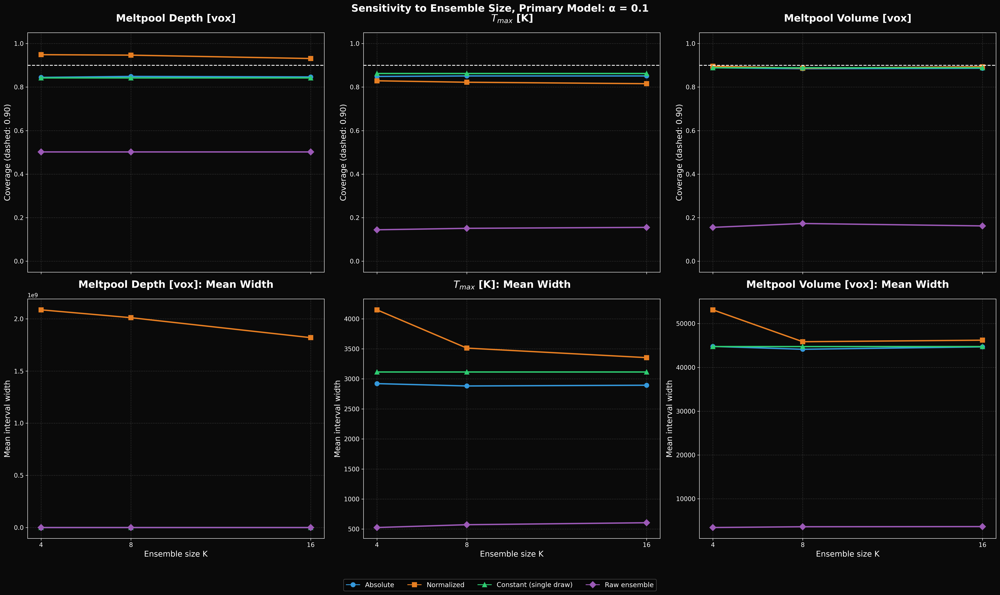

Second base seed (7002) on a subset of the test inputs:

| quantity | alpha | method | n | coverage_primary_seed | mean_width_primary_seed | coverage_second_seed | mean_width_second_seed |
| --- | --- | --- | --- | --- | --- | --- | --- |
| depth_vox | 0.200 | absolute | 45 | 0.689 | 30.000 | 0.689 | 30.000 |
| depth_vox | 0.200 | normalized | 45 | 0.889 | 39.318 | 0.867 | 36.917 |
| depth_vox | 0.100 | absolute | 45 | 0.822 | 44.375 | 0.822 | 44.375 |
| depth_vox | 0.100 | normalized | 45 | 0.911 | 2179164337 | 0.911 | 2046085143 |
| depth_vox | 0.050 | absolute | 45 | 0.844 | 55.500 | 0.867 | 55.500 |
| depth_vox | 0.050 | normalized | 45 | 0.956 | 3389811190 | 0.956 | 3182799112 |
| T_max_K | 0.200 | absolute | 45 | 0.756 | 2417 | 0.778 | 2417 |
| T_max_K | 0.200 | normalized | 45 | 0.756 | 2661 | 0.711 | 2565 |
| T_max_K | 0.100 | absolute | 45 | 0.844 | 2894 | 0.844 | 2894 |
| T_max_K | 0.100 | normalized | 45 | 0.822 | 3355 | 0.822 | 3234 |
| T_max_K | 0.050 | absolute | 45 | 0.889 | 3471 | 0.889 | 3471 |
| T_max_K | 0.050 | normalized | 45 | 0.889 | 4244 | 0.867 | 4090 |
| volume_vox | 0.200 | absolute | 45 | 0.844 | 33294 | 0.844 | 33294 |
| volume_vox | 0.200 | normalized | 45 | 0.822 | 33332 | 0.844 | 34147 |
| volume_vox | 0.100 | absolute | 45 | 0.911 | 44694 | 0.911 | 44694 |
| volume_vox | 0.100 | normalized | 45 | 0.911 | 47960 | 0.889 | 49133 |
| volume_vox | 0.050 | absolute | 45 | 0.911 | 54298 | 0.911 | 54298 |
| volume_vox | 0.050 | normalized | 45 | 0.956 | 59297 | 0.911 | 60746 |

## Leakage demonstration

The legacy Baseline (post-step mask, 3 training runs) under the same pipeline, labelled by actual overlap with its training data from `dataset_cfg`. The held-out n is an illustration, not a measurement.

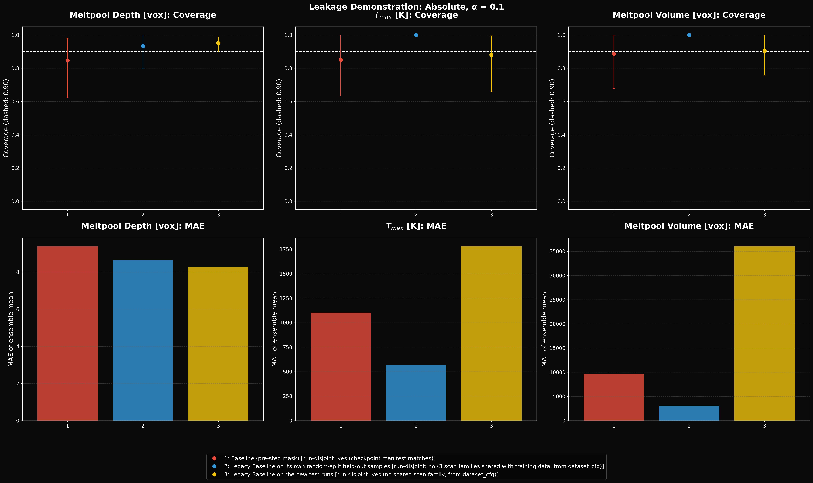

### Legacy Baseline on its own random-split held-out samples

**run-disjoint: no (3 scan families shared with training data, from dataset_cfg)**

n_cal = 30 (3 runs), n_test = 15 (3 runs), K = 16, base sampling seed = 7001.

Point error of the ensemble mean on the test runs:

| quantity | n | mae | rmse | bias | mean_spread |
| --- | --- | --- | --- | --- | --- |
| depth_vox | 15 | 8.637 | 10.855 | 8.637 | 1.751 |
| T_max_K | 15 | 566 | 641 | 566 | 241 |
| volume_vox | 15 | 3083 | 3805 | 688 | 1464 |

Coverage over all test samples:

| quantity | alpha | method | n | coverage | Wilson_95 | run_bootstrap_95 | mean_width | median_width | interval_score | support |
| --- | --- | --- | --- | --- | --- | --- | --- | --- | --- | --- |
| depth_vox | 0.200 | absolute | 15 | 0.933 | 0.702 to 0.988 | 0.800 to 1.000 | 34.875 | 34.875 | 39.958 | not supported at run level |
| depth_vox | 0.200 | normalized | 15 | 0.667 | 0.417 to 0.848 | 0.500 to 1.000 | 34.317 | 41.630 | 51.913 | not supported at run level |
| depth_vox | 0.200 | constant_single_draw | 15 | 0.867 | 0.621 to 0.963 | 0.500 to 1.000 | 36.000 | 36.000 | 41.333 | not supported at run level |
| depth_vox | 0.200 | raw_ensemble | 15 | 0.133 | 0.037 to 0.379 | 0.000 to 0.200 | 4.487 | 5.455 | 68.427 | not supported at run level |
| depth_vox | 0.100 | absolute | 15 | 0.933 | 0.702 to 0.988 | 0.800 to 1.000 | 37.875 | 37.875 | 46.042 | not supported at run level |
| depth_vox | 0.100 | normalized | 15 | 0.800 | 0.548 to 0.930 | 0.625 to 1.000 | 336 | 407 | 358 | not supported at run level |
| depth_vox | 0.100 | constant_single_draw | 15 | 0.933 | 0.702 to 0.988 | 0.800 to 1.000 | 38.000 | 38.000 | 46.000 | not supported at run level |
| depth_vox | 0.100 | raw_ensemble | 15 | 0.133 | 0.037 to 0.379 | 0.000 to 0.200 | 5.759 | 7.001 | 121 | not supported at run level |
| depth_vox | 0.050 | absolute | 15 | 0.933 | 0.702 to 0.988 | 0.800 to 1.000 | 42.250 | 42.250 | 52.750 | not supported at run level |
| depth_vox | 0.050 | normalized | 15 | 1.000 | 0.796 to 1.000 | 1.000 to 1.000 | 2182 | 2647 | 2182 | not supported at run level |
| depth_vox | 0.050 | constant_single_draw | 15 | 0.933 | 0.702 to 0.988 | 0.800 to 1.000 | 46.000 | 46.000 | 51.333 | not supported at run level |
| depth_vox | 0.050 | raw_ensemble | 15 | 0.133 | 0.037 to 0.379 | 0.000 to 0.200 | 6.862 | 8.342 | 215 | not supported at run level |
| T_max_K | 0.200 | absolute | 15 | 0.933 | 0.702 to 0.988 | 0.500 to 1.000 | 1785 | 1785 | 1800 | not supported at run level |
| T_max_K | 0.200 | normalized | 15 | 0.533 | 0.301 to 0.752 | 0.000 to 0.875 | 1437 | 1392 | 2313 | not supported at run level |
| T_max_K | 0.200 | constant_single_draw | 15 | 0.733 | 0.480 to 0.891 | 0.400 to 1.000 | 1926 | 1926 | 2069 | not supported at run level |
| T_max_K | 0.200 | raw_ensemble | 15 | 0.267 | 0.109 to 0.520 | 0.000 to 0.500 | 619 | 599 | 3647 | not supported at run level |
| T_max_K | 0.100 | absolute | 15 | 1.000 | 0.796 to 1.000 | 1.000 to 1.000 | 1873 | 1873 | 1873 | not supported at run level |
| T_max_K | 0.100 | normalized | 15 | 0.533 | 0.301 to 0.752 | 0.000 to 0.875 | 1545 | 1496 | 2856 | not supported at run level |
| T_max_K | 0.100 | constant_single_draw | 15 | 1.000 | 0.796 to 1.000 | 1.000 to 1.000 | 2315 | 2315 | 2315 | not supported at run level |
| T_max_K | 0.100 | raw_ensemble | 15 | 0.333 | 0.152 to 0.583 | 0.000 to 0.625 | 794 | 769 | 5697 | not supported at run level |
| T_max_K | 0.050 | absolute | 15 | 1.000 | 0.796 to 1.000 | 1.000 to 1.000 | 1988 | 1988 | 1988 | not supported at run level |
| T_max_K | 0.050 | normalized | 15 | 0.867 | 0.621 to 0.963 | 0.600 to 1.000 | 2015 | 1951 | 2919 | not supported at run level |
| T_max_K | 0.050 | constant_single_draw | 15 | 1.000 | 0.796 to 1.000 | 1.000 to 1.000 | 2413 | 2413 | 2413 | not supported at run level |
| T_max_K | 0.050 | raw_ensemble | 15 | 0.400 | 0.198 to 0.643 | 0.000 to 0.750 | 946 | 916 | 8890 | not supported at run level |
| volume_vox | 0.200 | absolute | 15 | 1.000 | 0.796 to 1.000 | 1.000 to 1.000 | 18949 | 18949 | 18949 | not supported at run level |
| volume_vox | 0.200 | normalized | 15 | 0.933 | 0.702 to 0.988 | 0.875 to 1.000 | 17304 | 16239 | 17785 | not supported at run level |
| volume_vox | 0.200 | constant_single_draw | 15 | 0.933 | 0.702 to 0.988 | 0.875 to 1.000 | 13434 | 13434 | 13702 | not supported at run level |
| volume_vox | 0.200 | raw_ensemble | 15 | 0.400 | 0.198 to 0.643 | 0.000 to 1.000 | 3753 | 3520 | 18953 | not supported at run level |
| volume_vox | 0.100 | absolute | 15 | 1.000 | 0.796 to 1.000 | 1.000 to 1.000 | 39066 | 39066 | 39066 | not supported at run level |
| volume_vox | 0.100 | normalized | 15 | 1.000 | 0.796 to 1.000 | 1.000 to 1.000 | 36419 | 34177 | 36419 | not supported at run level |
| volume_vox | 0.100 | constant_single_draw | 15 | 1.000 | 0.796 to 1.000 | 1.000 to 1.000 | 38470 | 38470 | 38470 | not supported at run level |
| volume_vox | 0.100 | raw_ensemble | 15 | 0.533 | 0.301 to 0.752 | 0.200 to 1.000 | 4817 | 4518 | 29409 | not supported at run level |
| volume_vox | 0.050 | absolute | 15 | 1.000 | 0.796 to 1.000 | 1.000 to 1.000 | 62161 | 62161 | 62161 | not supported at run level |
| volume_vox | 0.050 | normalized | 15 | 1.000 | 0.796 to 1.000 | 1.000 to 1.000 | 95817 | 89919 | 95817 | not supported at run level |
| volume_vox | 0.050 | constant_single_draw | 15 | 1.000 | 0.796 to 1.000 | 1.000 to 1.000 | 66094 | 66094 | 66094 | not supported at run level |
| volume_vox | 0.050 | raw_ensemble | 15 | 0.533 | 0.301 to 0.752 | 0.200 to 1.000 | 5740 | 5384 | 46074 | not supported at run level |

Coverage per material (absolute, alpha = 0.1):

| quantity | stratum | n | n_runs | coverage | Wilson_95 | run_bootstrap_95 | mean_width |
| --- | --- | --- | --- | --- | --- | --- | --- |
| depth_vox | IN718 | 5 | 1 | 0.800 | 0.376 to 0.964 | 0.800 to 0.800 | 37.875 |
| depth_vox | SS316L | 10 | 2 | 1.000 | 0.722 to 1.000 | 1.000 to 1.000 | 37.875 |
| T_max_K | IN718 | 5 | 1 | 1.000 | 0.566 to 1.000 | 1.000 to 1.000 | 1873 |
| T_max_K | SS316L | 10 | 2 | 1.000 | 0.722 to 1.000 | 1.000 to 1.000 | 1873 |
| volume_vox | IN718 | 5 | 1 | 1.000 | 0.566 to 1.000 | 1.000 to 1.000 | 39066 |
| volume_vox | SS316L | 10 | 2 | 1.000 | 0.722 to 1.000 | 1.000 to 1.000 | 39066 |

Coverage per pattern (absolute, alpha = 0.1):

| quantity | stratum | n | n_runs | coverage | Wilson_95 | run_bootstrap_95 | mean_width |
| --- | --- | --- | --- | --- | --- | --- | --- |
| depth_vox | island | 13 | 2 | 0.923 | 0.667 to 0.986 | 0.800 to 1.000 | 37.875 |
| depth_vox | raster | 2 | 1 | 1.000 | 0.342 to 1.000 | 1.000 to 1.000 | 37.875 |
| T_max_K | island | 13 | 2 | 1.000 | 0.772 to 1.000 | 1.000 to 1.000 | 1873 |
| T_max_K | raster | 2 | 1 | 1.000 | 0.342 to 1.000 | 1.000 to 1.000 | 1873 |
| volume_vox | island | 13 | 2 | 1.000 | 0.772 to 1.000 | 1.000 to 1.000 | 39066 |
| volume_vox | raster | 2 | 1 | 1.000 | 0.342 to 1.000 | 1.000 to 1.000 | 39066 |

Per-run coverage spread (each test run counted once):

| quantity | min | median | max | count |
| --- | --- | --- | --- | --- |
| T_max_K | 1.000 | 1.000 | 1.000 | 3 |
| depth_vox | 0.800 | 1.000 | 1.000 | 3 |
| volume_vox | 1.000 | 1.000 | 1.000 | 3 |

Depth: zero-depth samples are 0.133 of the test set; domain-limited samples (depth reaches Nz) are 0.133. A zero-depth sample is an easy hit and a domain-limited one is censored, so read these strata separately:

| quantity | stratum | n | n_runs | coverage | Wilson_95 | run_bootstrap_95 | mean_width |
| --- | --- | --- | --- | --- | --- | --- | --- |
| depth_vox | melt_only | 13 | 2 | 0.923 | 0.667 to 0.986 | 0.800 to 1.000 | 37.875 |
| depth_vox | zero_depth | 2 | 1 | 1.000 | 0.342 to 1.000 | 1.000 to 1.000 | 37.875 |
| depth_vox | domain_limited | 2 | 2 | 1.000 | 0.342 to 1.000 | 1.000 to 1.000 | 37.875 |

Volume: zero-volume samples are 0.133 of the test set; patch-limited samples (melt touches a lateral patch face or the bottom) are 0.867. Their true volume is larger than the patch can show, so read these strata separately:

| quantity | stratum | n | n_runs | coverage | Wilson_95 | run_bootstrap_95 | mean_width |
| --- | --- | --- | --- | --- | --- | --- | --- |
| volume_vox | zero_volume | 2 | 1 | 1.000 | 0.342 to 1.000 | 1.000 to 1.000 | 39066 |
| volume_vox | patch_limited | 13 | 2 | 1.000 | 0.772 to 1.000 | 1.000 to 1.000 | 39066 |

T_max coverage by true temperature range:

| quantity | stratum | n | n_runs | coverage | Wilson_95 | run_bootstrap_95 | mean_width |
| --- | --- | --- | --- | --- | --- | --- | --- |
| T_max_K | -inf to 2000 K | 4 | 2 | 1.000 | 0.510 to 1.000 | 1.000 to 1.000 | 1873 |
| T_max_K | 2000 to 3000 K | 8 | 2 | 1.000 | 0.676 to 1.000 | 1.000 to 1.000 | 1873 |
| T_max_K | 3000 to 5000 K | 3 | 1 | 1.000 | 0.439 to 1.000 | 1.000 to 1.000 | 1873 |

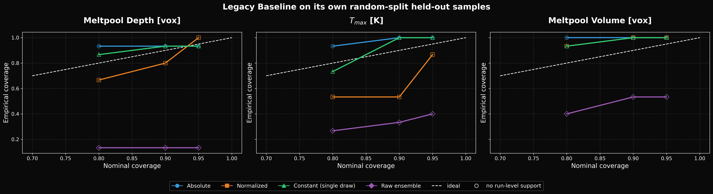

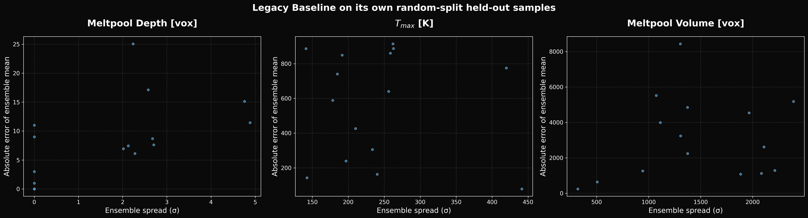

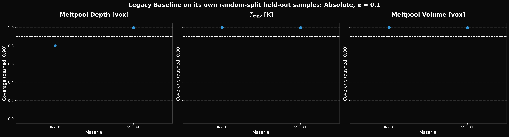

### Legacy Baseline on the new test runs

**run-disjoint: yes (no shared scan family, from dataset_cfg)**

n_cal = 590 (12 runs), n_test = 450 (9 runs), K = 16, base sampling seed = 7001.

Point error of the ensemble mean on the test runs:

| quantity | n | mae | rmse | bias | mean_spread |
| --- | --- | --- | --- | --- | --- |
| depth_vox | 450 | 8.253 | 12.021 | 6.193 | 1.585 |
| T_max_K | 450 | 1778 | 2906 | -1030 | 296 |
| volume_vox | 450 | 36008 | 59599 | -34835 | 3083 |

Coverage over all test samples:

| quantity | alpha | method | n | coverage | Wilson_95 | run_bootstrap_95 | mean_width | median_width | interval_score | support |
| --- | --- | --- | --- | --- | --- | --- | --- | --- | --- | --- |
| depth_vox | 0.200 | absolute | 450 | 0.776 | 0.735 to 0.812 | 0.576 to 0.911 | 32.500 | 32.500 | 42.303 | supported |
| depth_vox | 0.200 | normalized | 450 | 0.860 | 0.825 to 0.889 | 0.704 to 1.000 | 28.485 | 11.699 | 37.338 | supported |
| depth_vox | 0.200 | constant_single_draw | 450 | 0.804 | 0.765 to 0.838 | 0.627 to 0.933 | 34.000 | 34.000 | 44.111 | supported |
| depth_vox | 0.200 | raw_ensemble | 450 | 0.471 | 0.425 to 0.517 | 0.187 to 0.760 | 4.064 | 1.669 | 66.598 | supported |
| depth_vox | 0.100 | absolute | 450 | 0.951 | 0.927 to 0.967 | 0.898 to 0.989 | 44.000 | 44.000 | 48.764 | supported |
| depth_vox | 0.100 | normalized | 450 | 0.982 | 0.965 to 0.991 | 0.958 to 1.000 | 1585435886 | 651134629 | 1585435888 | supported |
| depth_vox | 0.100 | constant_single_draw | 450 | 0.936 | 0.909 to 0.955 | 0.880 to 0.978 | 44.000 | 44.000 | 50.667 | supported |
| depth_vox | 0.100 | raw_ensemble | 450 | 0.478 | 0.432 to 0.524 | 0.189 to 0.771 | 5.216 | 2.142 | 119 | supported |
| depth_vox | 0.050 | absolute | 450 | 0.978 | 0.960 to 0.988 | 0.956 to 0.996 | 49.625 | 49.625 | 55.336 | not supported at run level |
| depth_vox | 0.050 | normalized | 450 | 0.998 | 0.988 to 1.000 | 0.993 to 1.000 | 4439220482 | 1823176962 | 4439220482 | not supported at run level |
| depth_vox | 0.050 | constant_single_draw | 450 | 0.973 | 0.954 to 0.985 | 0.949 to 0.993 | 50.000 | 50.000 | 57.200 | not supported at run level |
| depth_vox | 0.050 | raw_ensemble | 450 | 0.480 | 0.434 to 0.526 | 0.193 to 0.771 | 6.215 | 2.552 | 215 | not supported at run level |
| T_max_K | 0.200 | absolute | 450 | 0.747 | 0.705 to 0.785 | 0.489 to 0.931 | 4544 | 4544 | 11165 | supported |
| T_max_K | 0.200 | normalized | 450 | 0.773 | 0.732 to 0.810 | 0.542 to 0.947 | 4974 | 4774 | 11934 | supported |
| T_max_K | 0.200 | constant_single_draw | 450 | 0.749 | 0.707 to 0.787 | 0.493 to 0.936 | 4476 | 4476 | 11202 | supported |
| T_max_K | 0.200 | raw_ensemble | 450 | 0.276 | 0.236 to 0.319 | 0.082 to 0.551 | 759 | 728 | 15266 | supported |
| T_max_K | 0.100 | absolute | 450 | 0.880 | 0.847 to 0.907 | 0.658 to 0.996 | 6826 | 6826 | 16285 | supported |
| T_max_K | 0.100 | normalized | 450 | 0.864 | 0.830 to 0.893 | 0.647 to 0.987 | 8001 | 7680 | 17453 | supported |
| T_max_K | 0.100 | constant_single_draw | 450 | 0.880 | 0.847 to 0.907 | 0.658 to 0.996 | 6709 | 6709 | 16269 | supported |
| T_max_K | 0.100 | raw_ensemble | 450 | 0.309 | 0.268 to 0.353 | 0.092 to 0.609 | 974 | 935 | 28457 | supported |
| T_max_K | 0.050 | absolute | 450 | 0.882 | 0.849 to 0.909 | 0.660 to 0.998 | 8081 | 8081 | 24025 | not supported at run level |
| T_max_K | 0.050 | normalized | 450 | 0.889 | 0.856 to 0.915 | 0.684 to 0.996 | 10708 | 10279 | 24326 | not supported at run level |
| T_max_K | 0.050 | constant_single_draw | 450 | 0.884 | 0.852 to 0.911 | 0.662 to 1.000 | 8238 | 8238 | 23720 | not supported at run level |
| T_max_K | 0.050 | raw_ensemble | 450 | 0.340 | 0.298 to 0.385 | 0.103 to 0.649 | 1161 | 1114 | 53614 | not supported at run level |
| volume_vox | 0.200 | absolute | 450 | 0.736 | 0.693 to 0.774 | 0.469 to 1.000 | 150989 | 150989 | 242951 | supported |
| volume_vox | 0.200 | normalized | 450 | 0.907 | 0.876 to 0.930 | 0.813 to 1.000 | 127117 | 81329 | 143432 | supported |
| volume_vox | 0.200 | constant_single_draw | 450 | 0.738 | 0.695 to 0.776 | 0.471 to 1.000 | 150624 | 150624 | 244091 | supported |
| volume_vox | 0.200 | raw_ensemble | 450 | 0.238 | 0.201 to 0.279 | 0.060 to 0.431 | 7902 | 5042 | 329483 | supported |
| volume_vox | 0.100 | absolute | 450 | 0.904 | 0.874 to 0.928 | 0.758 to 1.000 | 237459 | 237459 | 261425 | supported |
| volume_vox | 0.100 | normalized | 450 | 0.942 | 0.917 to 0.960 | 0.876 to 1.000 | 175345 | 112185 | 187683 | supported |
| volume_vox | 0.100 | constant_single_draw | 450 | 0.909 | 0.879 to 0.932 | 0.767 to 1.000 | 237148 | 237148 | 262713 | supported |
| volume_vox | 0.100 | raw_ensemble | 450 | 0.333 | 0.291 to 0.378 | 0.109 to 0.576 | 10143 | 6471 | 632396 | supported |
| volume_vox | 0.050 | absolute | 450 | 0.951 | 0.927 to 0.967 | 0.853 to 1.000 | 264688 | 264688 | 271592 | not supported at run level |
| volume_vox | 0.050 | normalized | 450 | 0.978 | 0.960 to 0.988 | 0.953 to 1.000 | 258848 | 165610 | 267837 | not supported at run level |
| volume_vox | 0.050 | constant_single_draw | 450 | 0.958 | 0.935 to 0.973 | 0.887 to 1.000 | 266468 | 266468 | 278394 | not supported at run level |
| volume_vox | 0.050 | raw_ensemble | 450 | 0.373 | 0.330 to 0.419 | 0.133 to 0.640 | 12086 | 7711 | 1220796 | not supported at run level |

Coverage per material (absolute, alpha = 0.1):

| quantity | stratum | n | n_runs | coverage | Wilson_95 | run_bootstrap_95 | mean_width |
| --- | --- | --- | --- | --- | --- | --- | --- |
| depth_vox | IN718 | 150 | 3 | 0.920 | 0.865 to 0.954 | 0.760 to 1.000 | 44.000 |
| depth_vox | SS316L | 150 | 3 | 0.980 | 0.943 to 0.993 | 0.940 to 1.000 | 44.000 |
| depth_vox | Ti64 | 150 | 3 | 0.953 | 0.907 to 0.977 | 0.920 to 0.980 | 44.000 |
| T_max_K | IN718 | 150 | 3 | 0.987 | 0.953 to 0.996 | 0.960 to 1.000 | 6826 |
| T_max_K | SS316L | 150 | 3 | 1.000 | 0.975 to 1.000 | 1.000 to 1.000 | 6826 |
| T_max_K | Ti64 | 150 | 3 | 0.653 | 0.574 to 0.725 | 0.000 to 1.000 | 6826 |
| volume_vox | IN718 | 150 | 3 | 1.000 | 0.975 to 1.000 | 1.000 to 1.000 | 237459 |
| volume_vox | SS316L | 150 | 3 | 1.000 | 0.975 to 1.000 | 1.000 to 1.000 | 237459 |
| volume_vox | Ti64 | 150 | 3 | 0.713 | 0.636 to 0.780 | 0.340 to 1.000 | 237459 |

Coverage per pattern (absolute, alpha = 0.1):

| quantity | stratum | n | n_runs | coverage | Wilson_95 | run_bootstrap_95 | mean_width |
| --- | --- | --- | --- | --- | --- | --- | --- |
| depth_vox | island | 150 | 3 | 0.993 | 0.963 to 0.999 | 0.980 to 1.000 | 44.000 |
| depth_vox | raster | 150 | 3 | 0.893 | 0.834 to 0.933 | 0.760 to 1.000 | 44.000 |
| depth_vox | zigzag | 150 | 3 | 0.967 | 0.924 to 0.986 | 0.940 to 1.000 | 44.000 |
| T_max_K | island | 150 | 3 | 1.000 | 0.975 to 1.000 | 1.000 to 1.000 | 6826 |
| T_max_K | raster | 150 | 3 | 0.987 | 0.953 to 0.996 | 0.960 to 1.000 | 6826 |
| T_max_K | zigzag | 150 | 3 | 0.653 | 0.574 to 0.725 | 0.000 to 1.000 | 6826 |
| volume_vox | island | 150 | 3 | 0.933 | 0.882 to 0.963 | 0.800 to 1.000 | 237459 |
| volume_vox | raster | 150 | 3 | 1.000 | 0.975 to 1.000 | 1.000 to 1.000 | 237459 |
| volume_vox | zigzag | 150 | 3 | 0.780 | 0.707 to 0.839 | 0.340 to 1.000 | 237459 |

Per-run coverage spread (each test run counted once):

| quantity | min | median | max | count |
| --- | --- | --- | --- | --- |
| T_max_K | 0.000 | 1.000 | 1.000 | 9 |
| depth_vox | 0.760 | 0.980 | 1.000 | 9 |
| volume_vox | 0.340 | 1.000 | 1.000 | 9 |

Depth: zero-depth samples are 0.333 of the test set; domain-limited samples (depth reaches Nz) are 0.493. A zero-depth sample is an easy hit and a domain-limited one is censored, so read these strata separately:

| quantity | stratum | n | n_runs | coverage | Wilson_95 | run_bootstrap_95 | mean_width |
| --- | --- | --- | --- | --- | --- | --- | --- |
| depth_vox | melt_only | 300 | 6 | 0.967 | 0.940 to 0.982 | 0.943 to 0.990 | 44.000 |
| depth_vox | zero_depth | 150 | 3 | 0.920 | 0.865 to 0.954 | 0.760 to 1.000 | 44.000 |
| depth_vox | domain_limited | 222 | 5 | 0.973 | 0.942 to 0.988 | 0.944 to 1.000 | 44.000 |

Volume: zero-volume samples are 0.333 of the test set; patch-limited samples (melt touches a lateral patch face or the bottom) are 0.662. Their true volume is larger than the patch can show, so read these strata separately:

| quantity | stratum | n | n_runs | coverage | Wilson_95 | run_bootstrap_95 | mean_width |
| --- | --- | --- | --- | --- | --- | --- | --- |
| volume_vox | zero_volume | 150 | 3 | 1.000 | 0.975 to 1.000 | 1.000 to 1.000 | 237459 |
| volume_vox | patch_limited | 298 | 6 | 0.856 | 0.811 to 0.891 | 0.634 to 1.000 | 237459 |
| volume_vox | melt_unlimited | 2 | 1 | 1.000 | 0.342 to 1.000 | 1.000 to 1.000 | 237459 |

T_max coverage by true temperature range:

| quantity | stratum | n | n_runs | coverage | Wilson_95 | run_bootstrap_95 | mean_width |
| --- | --- | --- | --- | --- | --- | --- | --- |
| T_max_K | -inf to 2000 K | 150 | 3 | 1.000 | 0.975 to 1.000 | 1.000 to 1.000 | 6826 |
| T_max_K | 2000 to 3000 K | 60 | 3 | 1.000 | 0.940 to 1.000 | 1.000 to 1.000 | 6826 |
| T_max_K | 3000 to 5000 K | 103 | 5 | 1.000 | 0.964 to 1.000 | 1.000 to 1.000 | 6826 |
| T_max_K | 5000 to inf K | 137 | 3 | 0.606 | 0.522 to 0.684 | 0.000 to 0.955 | 6826 |

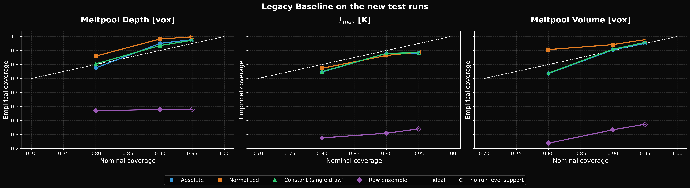

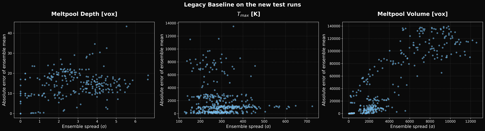

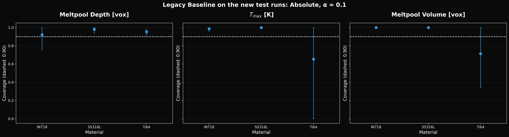

## Known limitations

- Results are on simulated data only, with no real-world validation cells.
- There is a small number of runs, so run-level intervals are wide.
- All legacy results use the post-step mask, which is derived from the predicted step. The new Baseline uses the causal `mask_in`.
- Melt-pool functionals use each sample's own T_l. Depth is capped by the domain height.
- Melt-pool volume is capped by the patch: a pool wider than the 64-voxel patch is truncated, so large volumes are lower bounds. The patch-limited stratum shows how often this happens.
- Temperatures are stored as float16, which limits T_max resolution at high temperatures.
- The model does not see T_in, so thermal history reaches it only through mask_in and conditioning.

## Timeline actually used

Includes time lost to crashes and restarts.

| stage | seconds, all executions | executions |
| --- | --- | --- |
| S0 preflight | 19 | 1 |
| S1 generate runs | 65062 | 2 |
| S2 validate dataset | 952 | 1 |
| S3 split manifest and pre-registration | 17 | 1 |
| S4 train Baseline | 28179 | 1 |
| S5 K-draw sampling | 38754 | 1 |
| S6 conformal, evaluation, report | 75 | 1 |
| total | 133059 (37.0 h) | |
